# Dokumentasi Database: `proyekGMN`

**Tanggal Digenerate:** 2026-09-25 18:18:34

---

## Diagram Relasi (ERD)

```mermaid
erDiagram
    material_out_header ||--o{ material_out_items : "material_out_id -> id"
    m_form_group ||--o{ m_form_name : "group_id -> id"
    m_form_name ||--o{ m_user_access_menu : "form_id -> id"
    m_user_system ||--o{ m_user_access_menu : "user_id -> id"
    m_employee ||--o{ m_user_system : "employee_id -> id"
    m_user_system ||--o{ m_user_login_status : "user_id -> id"
    m_form_name ||--o{ m_form_links : "form_id -> id"
    m_form_name ||--o{ m_form_links : "link_form_id -> id"
    m_location ||--o{ m_department : "location_id -> id"
    m_department ||--o{ employee_department : "department_id -> id"
    m_employee ||--o{ employee_department : "employee_id -> id"
    m_employee ||--o{ employee_section : "employee_id -> id"
    m_department ||--o{ department_section : "department_id -> id"
    m_employee ||--o{ employee_absence : "employee_id -> id"
    m_employee ||--o{ employee_allowance : "employee_id -> id"
    m_employee ||--o{ employee_position : "employee_id -> id"
    m_employee ||--o{ employee_sal : "employee_id -> id"
    m_employee ||--o{ employee_section_line : "employee_id -> id"
    m_employee ||--o{ employee_status : "employee_id -> id"
    clients ||--o{ projects : "client_id -> id"
    projects ||--o{ budget_items : "project_id -> id"
    materials ||--o{ budget_items : "material_id -> id"
    material_receipt_header ||--o{ material_receipt_items : "receipt_id -> id"
    materials ||--o{ material_receipt_items : "material_id -> id"
    bin_locations ||--o{ material_receipt_items : "bin_location_id -> id"
    projects ||--o{ purchase_orders : "project_id -> id"
    purchase_orders ||--o{ po_items : "po_id -> id"
    budget_items ||--o{ po_items : "budget_item_id -> id"
    materials ||--o{ po_items : "material_id -> id"
    projects ||--o{ warehouses : "project_id -> id"
    warehouses ||--o{ bin_locations : "warehouse_id -> id"
    projects ||--o{ material_receipt_header : "project_id -> id"
    purchase_orders ||--o{ material_receipt_header : "po_id -> id"
    pics ||--o{ material_receipt_header : "received_by -> id"
    pics ||--o{ material_receipt_header : "reversed_by -> id"
    coa_accounts ||--o{ coa_accounts : "parent_id -> id"
    chart_of_accounts ||--o{ supplier_payments : "account_id -> id"
    coa_accounts ||--o{ journal_entry_lines : "account_id -> id"
    projects ||--o{ journal_entry_lines : "project_id -> id"
    projects ||--o{ material_out_header : "project_id -> id"
    materials ||--o{ rab_materials : "material_id -> id"
    materials ||--o{ material_out_items : "material_id -> id"
    projects ||--o{ warehouses00 : "project_id -> id"
    projects ||--o{ rab_materials : "project_id -> id"
    warehouses ||--o{ material_out_header : "warehouse_id -> id"
    warehouses ||--o{ material_receipt_header : "warehouse_id -> id"
    m_location ||--o{ warehouses : "location_id -> id"
    m_location ||--o{ projects : "location_id -> id"
    m_employee ||--o{ projects : "pic_id -> id"
    chart_of_accounts ||--o{ chart_of_accounts : "parent_id -> id"
    chart_of_accounts ||--o{ purchase_payment_entries : "account_id -> id"
    chart_of_accounts ||--o{ general_ledger : "account_id -> id"
    chart_of_accounts ||--o{ payment_entries : "account_id -> id"
    chart_of_accounts ||--o{ fiscal_config : "credit_account_id -> id"
    chart_of_accounts ||--o{ fiscal_config : "debit_account_id -> id"
    journal_lines ||--o{ general_ledger : "journal_line_id -> id"
    accounting_periods ||--o{ journal_entries : "period_id -> id"
    m_user_system ||--o{ journal_entries : "posted_by -> id"
    chart_of_accounts ||--o{ journal_lines : "account_id -> id"
    journal_entries ||--o{ journal_lines : "journal_id -> id"
    m_contact_person ||--o{ m_address : "contact_person_id -> id"
    m_customer ||--o{ customer_npwp : "customer_id -> id"
    customer_npwp ||--o{ m_address : "npwp_id -> id"
    m_agent ||--o{ m_address : "agent_id -> id"
    m_country ||--o{ m_address : "country_id -> id"
    m_customer ||--o{ m_address : "customer_id -> id"
    m_village ||--o{ m_address : "village_id -> id"
    m_agent ||--o{ m_contact_person : "agent_id -> id"
    m_customer ||--o{ m_contact_person : "customer_id -> id"
    m_region ||--o{ m_country : "region_id -> id"
    m_district ||--o{ m_village : "district_id -> id"
    m_city ||--o{ m_district : "city_id -> id"
    m_agent ||--o{ m_contact_no : "agent_id -> id"
    m_contact_person ||--o{ m_contact_no : "contact_person_id -> id"
    m_customer ||--o{ m_contact_no : "customer_id -> id"
    purchase_orders ||--o{ grn_hdr : "po_id -> id"
    m_suppliers ||--o{ grn_hdr : "supplier_id -> id"
    grn_hdr ||--o{ grn_dtl : "grn_hdr_id -> id"
    po_items ||--o{ grn_dtl : "po_item_id -> id"
    grn_hdr ||--o{ wh_receiving_hdr : "grn_hdr_id -> id"
    purchase_invoice_hdr ||--o{ supplier_payment_items : "invoice_id -> id"
    supplier_payments ||--o{ supplier_payment_items : "supplier_payment_id -> id"
    wh_receiving_hdr ||--o{ wh_receiving_dtl : "wh_receiving_hdr_id -> id"
    grn_dtl ||--o{ wh_receiving_dtl : "grn_dtl_id -> id"
    item_group ||--o{ items : "group_id -> id"
    m_color ||--o{ items : "color_id -> id"
    m_unit ||--o{ items : "um_unit -> id"
    m_unit ||--o{ items : "um_packing -> id"
    m_suppliers ||--o{ purchase_orders : "supplier_id -> id"
    warehouses ||--o{ stock_movements : "warehouse_id -> id"
    warehouses ||--o{ wh_receiving_hdr : "warehouse_id -> id"
    materials ||--o{ grn_dtl : "item_id -> id"
    materials ||--o{ wh_receiving_dtl : "item_id -> id"
    materials ||--o{ stock_movements : "item_id -> id"
    m_currency ||--o{ purchase_orders : "currency_id -> id"
    bin_locations ||--o{ wh_receiving_dtl : "bin_location_id -> id"
    bin_locations ||--o{ material_out_items : "bin_location_id -> id"
    grn_hdr ||--o{ purchase_invoice_dtl : "grn_hdr_id -> id"
    m_suppliers ||--o{ purchase_invoice_hdr : "supplier_id -> id"
    purchase_invoice_hdr ||--o{ purchase_invoice_dtl : "invoice_hdr_id -> id"
    m_suppliers ||--o{ supplier_payments : "supplier_id -> id"
    wh_receiving_hdr ||--o{ purchase_return_hdr : "wh_receiving_hdr_id -> id"
    warehouses ||--o{ purchase_return_hdr : "warehouse_id -> id"
    grn_hdr ||--o{ purchase_return_hdr : "grn_hdr_id -> id"
    purchase_return_hdr ||--o{ purchase_return_dtl : "return_hdr_id -> id"
    wh_receiving_dtl ||--o{ purchase_return_dtl : "wh_receiving_dtl_id -> id"
    grn_dtl ||--o{ purchase_return_dtl : "grn_dtl_id -> id"
    m_currency ||--o{ tax_exchange_rate_dtl : "currency_id -> id"
    tax_exchange_rate_hdr ||--o{ tax_exchange_rate_dtl : "hdr_id -> id"
    projects ||--o{ project_invoices : "project_id -> id"
    clients ||--o{ project_payments : "client_id -> id"
    chart_of_accounts ||--o{ project_payments : "account_id -> id"
    project_payments ||--o{ project_payment_items : "payment_id -> id"
    project_invoices ||--o{ project_payment_items : "invoice_id -> id"
```

---

## Daftar Tabel

## Tabel: `accounting_periods`

| Kolom | Tipe Data | Nullable | Key | Default | Keterangan |
|---|---|:---:|:---:|---|---|
| `id` | `bigint` | **NO** | **PK** | `nextval('accounting_periods_id_seq'::regclass)` | - |
| `period_name` | `character varying(20)` | **NO** | - | - | - |
| `start_date` | `date` | **NO** | - | - | - |
| `end_date` | `date` | **NO** | - | - | - |
| `is_closed` | `boolean` | **NO** | - | `false` | - |

---

## Tabel: `backup_employee_department`

| Kolom | Tipe Data | Nullable | Key | Default | Keterangan |
|---|---|:---:|:---:|---|---|
| `id` | `bigint` | YES | - | - | - |
| `employee_id` | `bigint` | YES | - | - | - |
| `department_id` | `bigint` | YES | - | - | - |
| `from_date` | `date` | YES | - | - | - |
| `to_date` | `date` | YES | - | - | - |
| `from_time` | `time without time zone` | YES | - | - | - |
| `to_time` | `time without time zone` | YES | - | - | - |

---

## Tabel: `backup_employee_section`

| Kolom | Tipe Data | Nullable | Key | Default | Keterangan |
|---|---|:---:|:---:|---|---|
| `id` | `bigint` | YES | - | - | - |
| `employee_id` | `integer` | YES | - | - | - |
| `section_id` | `integer` | YES | - | - | - |
| `from_date` | `date` | YES | - | - | - |
| `to_date` | `date` | YES | - | - | - |
| `remark` | `text` | YES | - | - | - |
| `from_time` | `time without time zone` | YES | - | - | - |
| `to_time` | `time without time zone` | YES | - | - | - |

---

## Tabel: `bin_locations`

| Kolom | Tipe Data | Nullable | Key | Default | Keterangan |
|---|---|:---:|:---:|---|---|
| `id` | `integer` | **NO** | **PK** | `nextval('bin_locations_id_seq'::regclass)` | - |
| `warehouse_id` | `integer` | **NO** | FK | - | - |
| `code` | `character varying(30)` | **NO** | - | - | - |
| `name` | `character varying(100)` | YES | - | `''::character varying` | - |
| `zone` | `character varying(20)` | YES | - | `''::character varying` | - |
| `rack` | `character varying(20)` | YES | - | `''::character varying` | - |
| `level` | `character varying(20)` | YES | - | `''::character varying` | - |
| `active` | `boolean` | **NO** | - | `true` | - |

---

## Tabel: `budget_items`

| Kolom | Tipe Data | Nullable | Key | Default | Keterangan |
|---|---|:---:|:---:|---|---|
| `id` | `integer` | **NO** | **PK** | `nextval('budget_items_id_seq'::regclass)` | - |
| `project_id` | `integer` | **NO** | FK | - | - |
| `category` | `character varying(20)` | **NO** | - | `'Material'::character varying` | - |
| `material_id` | `integer` | YES | FK | - | - |
| `item_name` | `character varying(255)` | **NO** | - | - | - |
| `unit` | `character varying(30)` | YES | - | `''::character varying` | - |
| `qty_plan` | `numeric(18,3)` | YES | - | `0` | - |
| `unit_price_plan` | `numeric(18,2)` | YES | - | `0` | - |
| `tolerance_pct` | `numeric(5,2)` | YES | - | `0` | - |
| `notes` | `text` | YES | - | `''::text` | - |
| `created_at` | `timestamp without time zone` | **NO** | - | `now()` | - |

---

## Tabel: `chart_of_accounts`

| Kolom | Tipe Data | Nullable | Key | Default | Keterangan |
|---|---|:---:|:---:|---|---|
| `id` | `bigint` | **NO** | **PK** | `nextval('chart_of_accounts_id_seq'::regclass)` | - |
| `account_code` | `character varying(20)` | **NO** | - | - | - |
| `account_name` | `character varying(150)` | **NO** | - | - | - |
| `account_type` | `USER-DEFINED` | **NO** | - | - | - |
| `parent_id` | `bigint` | YES | FK | - | - |
| `is_active` | `boolean` | **NO** | - | `true` | - |

---

## Tabel: `clients`

| Kolom | Tipe Data | Nullable | Key | Default | Keterangan |
|---|---|:---:|:---:|---|---|
| `id` | `integer` | **NO** | **PK** | `nextval('clients_id_seq'::regclass)` | - |
| `name` | `character varying(255)` | **NO** | - | - | - |
| `contact_person` | `character varying(255)` | YES | - | `''::character varying` | - |
| `phone` | `character varying(50)` | YES | - | `''::character varying` | - |
| `email` | `character varying(255)` | YES | - | `''::character varying` | - |
| `address` | `text` | YES | - | `''::text` | - |
| `created_at` | `timestamp without time zone` | **NO** | - | `now()` | - |

---

## Tabel: `coa_accounts`

| Kolom | Tipe Data | Nullable | Key | Default | Keterangan |
|---|---|:---:|:---:|---|---|
| `id` | `integer` | **NO** | **PK** | `nextval('coa_accounts_id_seq'::regclass)` | - |
| `code` | `character varying(20)` | **NO** | - | - | - |
| `name` | `character varying(150)` | **NO** | - | - | - |
| `account_type` | `character varying(20)` | **NO** | - | - | - |
| `normal_balance` | `character varying(6)` | **NO** | - | - | - |
| `parent_id` | `integer` | YES | FK | - | - |
| `is_postable` | `boolean` | **NO** | - | `true` | - |
| `active` | `boolean` | **NO** | - | `true` | - |
| `created_at` | `timestamp without time zone` | **NO** | - | `now()` | - |

---

## Tabel: `customer_npwp`

| Kolom | Tipe Data | Nullable | Key | Default | Keterangan |
|---|---|:---:|:---:|---|---|
| `id` | `bigint` | **NO** | **PK** | `nextval('customer_npwp_id_seq'::regclass)` | - |
| `customer_id` | `integer` | YES | FK | - | - |
| `npwp_no` | `character varying(30)` | YES | - | - | - |
| `active` | `boolean` | YES | - | - | - |
| `address_office` | `boolean` | YES | - | `false` | - |

---

## Tabel: `data_log_delete`

| Kolom | Tipe Data | Nullable | Key | Default | Keterangan |
|---|---|:---:|:---:|---|---|
| `table_name` | `text` | YES | - | - | - |
| `user_name` | `text` | YES | - | - | - |
| `app_user_name` | `text` | YES | - | - | - |
| `action` | `text` | YES | - | - | - |
| `old_values` | `USER-DEFINED` | YES | - | - | - |
| `new_values` | `USER-DEFINED` | YES | - | - | - |
| `updated_cols` | `ARRAY` | YES | - | - | - |
| `query` | `text` | YES | - | - | - |
| `user_terminal` | `character varying(15)` | YES | - | - | - |
| `id` | `bigint` | **NO** | - | `nextval('data_log_delete_id_seq1'::regclass)` | - |
| `action_timestamp` | `timestamp without time zone` | **NO** | - | `now()` | - |

---

## Tabel: `data_log_insert`

| Kolom | Tipe Data | Nullable | Key | Default | Keterangan |
|---|---|:---:|:---:|---|---|
| `table_name` | `text` | YES | - | - | - |
| `user_name` | `text` | YES | - | - | - |
| `app_user_name` | `text` | YES | - | - | - |
| `action` | `text` | YES | - | - | - |
| `old_values` | `USER-DEFINED` | YES | - | - | - |
| `new_values` | `USER-DEFINED` | YES | - | - | - |
| `updated_cols` | `ARRAY` | YES | - | - | - |
| `query` | `text` | YES | - | - | - |
| `user_terminal` | `character varying(15)` | YES | - | - | - |
| `id` | `bigint` | **NO** | - | `nextval('data_log_insert_id_seq1'::regclass)` | - |
| `action_timestamp` | `timestamp without time zone` | **NO** | - | `now()` | - |

---

## Tabel: `data_log_update`

| Kolom | Tipe Data | Nullable | Key | Default | Keterangan |
|---|---|:---:|:---:|---|---|
| `table_name` | `text` | YES | - | - | - |
| `user_name` | `text` | YES | - | - | - |
| `app_user_name` | `text` | YES | - | - | - |
| `action` | `text` | YES | - | - | - |
| `old_values` | `USER-DEFINED` | YES | - | - | - |
| `new_values` | `USER-DEFINED` | YES | - | - | - |
| `updated_cols` | `ARRAY` | YES | - | - | - |
| `query` | `text` | YES | - | - | - |
| `user_terminal` | `character varying(15)` | YES | - | - | - |
| `id` | `bigint` | **NO** | - | `nextval('data_log_update_id_seq1'::regclass)` | - |
| `action_timestamp` | `timestamp without time zone` | **NO** | - | `now()` | - |

---

## Tabel: `department_section`

| Kolom | Tipe Data | Nullable | Key | Default | Keterangan |
|---|---|:---:|:---:|---|---|
| `id` | `bigint` | **NO** | **PK** | `nextval('department_section_id_seq'::regclass)` | - |
| `department_id` | `bigint` | YES | FK | - | - |
| `section_name` | `character varying(255)` | YES | - | - | - |
| `line_no` | `integer` | YES | - | - | - |
| `remark` | `text` | YES | - | - | - |
| `seq_no` | `integer` | YES | - | - | - |
| `data_output` | `boolean` | YES | - | - | - |
| `piece_rate` | `boolean` | YES | - | - | - |
| `operator` | `integer` | YES | - | - | - |
| `share_amt` | `boolean` | YES | - | - | - |
| `active` | `boolean` | YES | - | `true` | - |
| `warehouse_id` | `bigint` | YES | - | - | - |

---

## Tabel: `employee_absence`

| Kolom | Tipe Data | Nullable | Key | Default | Keterangan |
|---|---|:---:|:---:|---|---|
| `id` | `bigint` | **NO** | **PK** | `nextval('employee_absence_id_seq'::regclass)` | - |
| `employee_id` | `integer` | YES | FK | - | - |
| `nik` | `bigint` | YES | - | - | - |
| `absence_date` | `date` | YES | - | - | - |
| `absence_in` | `time without time zone` | YES | - | - | - |
| `absence_out` | `time without time zone` | YES | - | - | - |
| `leave_id` | `integer` | YES | - | - | - |
| `remark` | `text` | YES | - | - | - |

---

## Tabel: `employee_absence_detail_period`

| Kolom | Tipe Data | Nullable | Key | Default | Keterangan |
|---|---|:---:|:---:|---|---|
| `from_date` | `date` | YES | - | - | - |
| `to_date` | `date` | YES | - | - | - |
| `absence_id` | `bigint` | YES | - | - | - |
| `leave_id` | `integer` | YES | - | - | - |
| `employee_id` | `integer` | YES | - | - | - |
| `nik` | `bigint` | YES | - | - | - |
| `absence_date` | `date` | YES | - | - | - |
| `absence_day` | `double precision` | YES | - | - | - |
| `day_off` | `boolean` | YES | - | - | - |
| `working_day` | `integer` | YES | - | - | - |
| `from_time` | `time without time zone` | YES | - | - | - |
| `to_time` | `time without time zone` | YES | - | - | - |
| `absence_in` | `time without time zone` | YES | - | - | - |
| `absence_out` | `time without time zone` | YES | - | - | - |
| `rest_hours` | `numeric` | YES | - | - | - |
| `hour_amount` | `integer` | YES | - | - | - |
| `daily_amount` | `numeric` | YES | - | - | - |
| `pw_amount` | `numeric` | YES | - | - | - |
| `is_late` | `boolean` | YES | - | - | - |
| `min_late` | `double precision` | YES | - | - | - |
| `is_early` | `boolean` | YES | - | - | - |
| `off_hours` | `double precision` | YES | - | - | - |
| `w_hours` | `double precision` | YES | - | - | - |
| `overtime` | `double precision` | YES | - | - | - |
| `overtime_amount` | `double precision` | YES | - | - | - |
| `overtime_holiday` | `double precision` | YES | - | - | - |
| `overtime_holiday_amount` | `double precision` | YES | - | - | - |
| `wages` | `integer` | YES | - | - | - |
| `total_amount` | `double precision` | YES | - | - | - |
| `absence_status` | `text` | YES | - | - | - |
| `remark` | `text` | YES | - | - | - |
| `u_makan` | `numeric` | YES | - | - | - |
| `u_transport` | `numeric` | YES | - | - | - |
| `u_tunjangan` | `numeric` | YES | - | - | - |
| `u_debu` | `numeric` | YES | - | - | - |
| `tnj_fooding` | `integer` | YES | - | - | - |
| `pw_incentive` | `numeric` | YES | - | - | - |

---

## Tabel: `employee_absence_header_period`

| Kolom | Tipe Data | Nullable | Key | Default | Keterangan |
|---|---|:---:|:---:|---|---|
| `from_date` | `date` | YES | - | - | - |
| `to_date` | `date` | YES | - | - | - |
| `location_init` | `character varying(50)` | YES | - | - | - |
| `location_id` | `bigint` | YES | - | - | - |
| `location_name` | `character varying(255)` | YES | - | - | - |
| `department_id` | `bigint` | YES | - | - | - |
| `department_name` | `character varying(255)` | YES | - | - | - |
| `section_id` | `bigint` | YES | - | - | - |
| `section_name` | `text` | YES | - | - | - |
| `employee_name` | `text` | YES | - | - | - |
| `employee_id` | `integer` | YES | - | - | - |
| `nik` | `integer` | YES | - | - | - |
| `working_day` | `bigint` | YES | - | - | - |
| `employee_absence` | `bigint` | YES | - | - | - |
| `employee_early` | `bigint` | YES | - | - | - |
| `employee_late` | `bigint` | YES | - | - | - |
| `employee_leave` | `bigint` | YES | - | - | - |
| `overtime` | `double precision` | YES | - | - | - |
| `overtime_amount` | `double precision` | YES | - | - | - |
| `overtime_holiday` | `double precision` | YES | - | - | - |
| `overtime_holiday_amount` | `double precision` | YES | - | - | - |
| `total_amount` | `double precision` | YES | - | - | - |
| `d_total` | `bigint` | YES | - | - | - |
| `d_amount` | `numeric` | YES | - | - | - |
| `p_total` | `bigint` | YES | - | - | - |
| `p_amount` | `numeric` | YES | - | - | - |

---

## Tabel: `employee_addtn_allowance`

| Kolom | Tipe Data | Nullable | Key | Default | Keterangan |
|---|---|:---:|:---:|---|---|
| `id` | `bigint` | **NO** | **PK** | `nextval('employee_addtn_allowance_id_seq'::regclass)` | - |
| `employee_id` | `integer` | YES | - | - | - |
| `period_id` | `integer` | YES | - | - | - |
| `allowance` | `character varying(255)` | YES | - | - | - |
| `amount` | `numeric(12,2)` | YES | - | - | - |
| `remark` | `text` | YES | - | - | - |

---

## Tabel: `employee_addtn_instalment`

| Kolom | Tipe Data | Nullable | Key | Default | Keterangan |
|---|---|:---:|:---:|---|---|
| `id` | `bigint` | **NO** | **PK** | `nextval('employee_addtn_instalment_id_seq'::regclass)` | - |
| `employee_id` | `integer` | YES | - | - | - |
| `period_id` | `integer` | YES | - | - | - |
| `instalment` | `character varying(255)` | YES | - | - | - |
| `amount` | `numeric(12,2)` | YES | - | - | - |
| `remark` | `text` | YES | - | - | - |

---

## Tabel: `employee_addtn_ot`

| Kolom | Tipe Data | Nullable | Key | Default | Keterangan |
|---|---|:---:|:---:|---|---|
| `id` | `bigint` | **NO** | **PK** | `nextval('employee_addtn_ot_id_seq'::regclass)` | - |
| `period_id` | `integer` | YES | - | - | - |
| `employee_id` | `integer` | YES | - | - | - |
| `ot` | `numeric(12,2)` | YES | - | - | - |
| `amount` | `numeric(12,2)` | YES | - | - | - |
| `remark` | `text` | YES | - | - | - |

---

## Tabel: `employee_addtn_ot_h`

| Kolom | Tipe Data | Nullable | Key | Default | Keterangan |
|---|---|:---:|:---:|---|---|
| `id` | `bigint` | **NO** | **PK** | `nextval('employee_addtn_ot_h_id_seq'::regclass)` | - |
| `period_id` | `integer` | YES | - | - | - |
| `employee_id` | `integer` | YES | - | - | - |
| `ot` | `numeric(12,2)` | YES | - | - | - |
| `amount` | `numeric(12,2)` | YES | - | - | - |
| `remark` | `text` | YES | - | - | - |

---

## Tabel: `employee_allowance`

| Kolom | Tipe Data | Nullable | Key | Default | Keterangan |
|---|---|:---:|:---:|---|---|
| `id` | `bigint` | **NO** | **PK** | `nextval('employee_allowance_id_seq'::regclass)` | - |
| `employee_id` | `integer` | YES | FK | - | - |
| `allowance_id` | `integer` | YES | - | - | - |
| `amount` | `numeric(12,2)` | YES | - | - | - |
| `from_date` | `date` | YES | - | - | - |
| `to_date` | `date` | YES | - | - | - |
| `remak` | `text` | YES | - | - | - |

---

## Tabel: `employee_department`

| Kolom | Tipe Data | Nullable | Key | Default | Keterangan |
|---|---|:---:|:---:|---|---|
| `id` | `bigint` | **NO** | **PK** | `nextval('employee_department_id_seq'::regclass)` | - |
| `employee_id` | `bigint` | YES | FK | - | - |
| `department_id` | `bigint` | YES | FK | - | - |
| `from_date` | `date` | YES | - | - | - |
| `to_date` | `date` | YES | - | - | - |
| `from_time` | `time without time zone` | YES | - | `'00:00:00'::time without time zone` | - |
| `to_time` | `time without time zone` | YES | - | `'00:00:00'::time without time zone` | - |

---

## Tabel: `employee_instalment`

| Kolom | Tipe Data | Nullable | Key | Default | Keterangan |
|---|---|:---:|:---:|---|---|
| `id` | `bigint` | **NO** | **PK** | `nextval('employee_instalment_id_seq'::regclass)` | - |
| `employee_id` | `integer` | YES | - | - | - |
| `instalment_id` | `integer` | YES | - | - | - |
| `amount` | `numeric(12,2)` | YES | - | - | - |
| `from_date` | `date` | YES | - | - | - |
| `to_date` | `date` | YES | - | - | - |

---

## Tabel: `employee_new_rek1`

| Kolom | Tipe Data | Nullable | Key | Default | Keterangan |
|---|---|:---:|:---:|---|---|
| `rownum` | `bigint` | YES | - | - | - |
| `employee_id` | `bigint` | YES | - | - | - |
| `location_name` | `character varying(255)` | YES | - | - | - |
| `department_name` | `character varying(255)` | YES | - | - | - |
| `section_name` | `character varying(255)` | YES | - | - | - |
| `name` | `text` | YES | - | - | - |
| `active` | `boolean` | YES | - | - | - |
| `ktp_s` | `text` | YES | - | - | - |
| `bank_account_no` | `character varying(100)` | YES | - | - | - |
| `new_account` | `character varying(255)` | YES | - | - | - |
| `ktp_p` | `character varying(255)` | YES | - | - | - |

---

## Tabel: `employee_payroll_dtl_close`

| Kolom | Tipe Data | Nullable | Key | Default | Keterangan |
|---|---|:---:|:---:|---|---|
| `from_date` | `date` | YES | - | - | - |
| `to_date` | `date` | YES | - | - | - |
| `absence_id` | `bigint` | YES | - | - | - |
| `leave_id` | `integer` | YES | - | - | - |
| `location_id` | `bigint` | YES | - | - | - |
| `department_id` | `bigint` | YES | - | - | - |
| `section_id` | `integer` | YES | - | - | - |
| `employee_id` | `integer` | YES | - | - | - |
| `nik` | `bigint` | YES | - | - | - |
| `absence_date` | `date` | YES | - | - | - |
| `absence_day` | `double precision` | YES | - | - | - |
| `day_off` | `boolean` | YES | - | - | - |
| `working_day` | `integer` | YES | - | - | - |
| `from_time` | `time without time zone` | YES | - | - | - |
| `to_time` | `time without time zone` | YES | - | - | - |
| `absence_in` | `time without time zone` | YES | - | - | - |
| `absence_out` | `time without time zone` | YES | - | - | - |
| `daily_amount` | `numeric` | YES | - | - | - |
| `pw_amount` | `numeric` | YES | - | - | - |
| `is_late` | `boolean` | YES | - | - | - |
| `min_late` | `double precision` | YES | - | - | - |
| `is_early` | `boolean` | YES | - | - | - |
| `off_hours` | `double precision` | YES | - | - | - |
| `w_hours` | `double precision` | YES | - | - | - |
| `overtime` | `double precision` | YES | - | - | - |
| `overtime_amount` | `double precision` | YES | - | - | - |
| `overtime_holiday` | `double precision` | YES | - | - | - |
| `overtime_holiday_amount` | `double precision` | YES | - | - | - |
| `wages` | `double precision` | YES | - | - | - |
| `total_amount` | `double precision` | YES | - | - | - |
| `absence_status` | `text` | YES | - | - | - |
| `remark` | `text` | YES | - | - | - |
| `u_makan` | `numeric` | YES | - | - | - |
| `u_transport` | `numeric` | YES | - | - | - |
| `u_tunjangan` | `numeric` | YES | - | - | - |
| `u_debu` | `numeric` | YES | - | - | - |
| `tnj_fooding` | `integer` | YES | - | - | - |
| `pw_incentive` | `numeric` | YES | - | - | - |

---

## Tabel: `employee_payroll_hdr_close`

| Kolom | Tipe Data | Nullable | Key | Default | Keterangan |
|---|---|:---:|:---:|---|---|
| `from_date` | `date` | YES | - | - | - |
| `to_date` | `date` | YES | - | - | - |
| `location_init` | `character varying(50)` | YES | - | - | - |
| `location_id` | `bigint` | YES | - | - | - |
| `location_name` | `character varying(255)` | YES | - | - | - |
| `department_id` | `bigint` | YES | - | - | - |
| `department_name` | `character varying(255)` | YES | - | - | - |
| `section_id` | `bigint` | YES | - | - | - |
| `section_name` | `text` | YES | - | - | - |
| `employee_name` | `text` | YES | - | - | - |
| `employee_id` | `integer` | YES | - | - | - |
| `nik` | `integer` | YES | - | - | - |
| `working_day` | `bigint` | YES | - | - | - |
| `employee_absence` | `bigint` | YES | - | - | - |
| `employee_early` | `bigint` | YES | - | - | - |
| `employee_late` | `bigint` | YES | - | - | - |
| `employee_leave` | `bigint` | YES | - | - | - |
| `overtime` | `double precision` | YES | - | - | - |
| `overtime_amount` | `double precision` | YES | - | - | - |
| `overtime_holiday` | `double precision` | YES | - | - | - |
| `overtime_holiday_amount` | `double precision` | YES | - | - | - |
| `total_amount` | `double precision` | YES | - | - | - |
| `d_total` | `bigint` | YES | - | - | - |
| `d_amount` | `double precision` | YES | - | - | - |
| `p_total` | `bigint` | YES | - | - | - |
| `p_amount` | `numeric` | YES | - | - | - |

---

## Tabel: `employee_position`

| Kolom | Tipe Data | Nullable | Key | Default | Keterangan |
|---|---|:---:|:---:|---|---|
| `id` | `bigint` | **NO** | **PK** | `nextval('employee_position_id_seq'::regclass)` | - |
| `employee_id` | `integer` | YES | FK | - | - |
| `position_id` | `integer` | YES | - | - | - |
| `level` | `numeric(3,0)` | YES | - | - | - |
| `from_date` | `date` | YES | - | - | - |
| `to_date` | `date` | YES | - | - | - |
| `remark` | `text` | YES | - | - | - |

---

## Tabel: `employee_premi_062018`

| Kolom | Tipe Data | Nullable | Key | Default | Keterangan |
|---|---|:---:|:---:|---|---|
| `employee_id` | `integer` | YES | - | - | - |
| `location_name` | `character varying(255)` | YES | - | - | - |
| `department_name` | `character varying(255)` | YES | - | - | - |
| `section_name` | `character varying(255)` | YES | - | - | - |
| `employee_name` | `character varying(255)` | YES | - | - | - |

---

## Tabel: `employee_rekening_mayapada`

| Kolom | Tipe Data | Nullable | Key | Default | Keterangan |
|---|---|:---:|:---:|---|---|
| `id` | `bigint` | YES | - | - | - |
| `nik` | `integer` | YES | - | - | - |
| `employee_name` | `character varying(255)` | YES | - | - | - |
| `id_number` | `character varying(100)` | YES | - | - | - |
| `bank_account_no` | `character varying(100)` | YES | - | - | - |

---

## Tabel: `employee_sal`

| Kolom | Tipe Data | Nullable | Key | Default | Keterangan |
|---|---|:---:|:---:|---|---|
| `id` | `bigint` | **NO** | **PK** | `nextval('employee_sal_id_seq'::regclass)` | - |
| `employee_id` | `integer` | YES | FK | - | - |
| `amount` | `numeric(12,2)` | YES | - | - | - |
| `daily` | `boolean` | YES | - | - | - |
| `from_date` | `date` | YES | - | - | - |
| `to_date` | `date` | YES | - | - | - |
| `remark` | `text` | YES | - | - | - |

---

## Tabel: `employee_section`

| Kolom | Tipe Data | Nullable | Key | Default | Keterangan |
|---|---|:---:|:---:|---|---|
| `id` | `bigint` | **NO** | **PK** | `nextval('employee_section_id_seq'::regclass)` | - |
| `employee_id` | `integer` | YES | FK | - | - |
| `section_id` | `integer` | YES | - | - | - |
| `from_date` | `date` | YES | - | - | - |
| `to_date` | `date` | YES | - | - | - |
| `remark` | `text` | YES | - | - | - |
| `from_time` | `time without time zone` | YES | - | `'00:00:00'::time without time zone` | - |
| `to_time` | `time without time zone` | YES | - | `'00:00:00'::time without time zone` | - |

---

## Tabel: `employee_section_line`

| Kolom | Tipe Data | Nullable | Key | Default | Keterangan |
|---|---|:---:|:---:|---|---|
| `id` | `bigint` | **NO** | **PK** | `nextval('employee_section_line_id_seq'::regclass)` | - |
| `section_line_id` | `integer` | YES | - | - | - |
| `employee_id` | `integer` | YES | FK | - | - |
| `from_date` | `date` | YES | - | - | - |
| `to_date` | `date` | YES | - | - | - |
| `employe_status_id` | `integer` | YES | - | - | - |

---

## Tabel: `employee_slip_periode`

| Kolom | Tipe Data | Nullable | Key | Default | Keterangan |
|---|---|:---:|:---:|---|---|
| `period` | `text` | YES | - | - | - |
| `location_init` | `character varying(50)` | YES | - | - | - |
| `location_name` | `character varying(255)` | YES | - | - | - |
| `section_seq` | `bigint` | YES | - | - | - |
| `department_section` | `text` | YES | - | - | - |
| `sub` | `text` | YES | - | - | - |
| `section_name` | `text` | YES | - | - | - |
| `department_name` | `character varying(255)` | YES | - | - | - |
| `depart_seq` | `bigint` | YES | - | - | - |
| `status_name` | `character varying(255)` | YES | - | - | - |
| `employee_name` | `text` | YES | - | - | - |
| `employee_id` | `integer` | YES | - | - | - |
| `nik` | `integer` | YES | - | - | - |
| `working_day` | `bigint` | YES | - | - | - |
| `u_makan` | `numeric` | YES | - | - | - |
| `u_transport` | `numeric` | YES | - | - | - |
| `u_debu` | `numeric` | YES | - | - | - |
| `tnj_fooding` | `bigint` | YES | - | - | - |
| `total_amount` | `double precision` | YES | - | - | - |
| `d_total` | `bigint` | YES | - | - | - |
| `d_amount` | `double precision` | YES | - | - | - |
| `p_total` | `bigint` | YES | - | - | - |
| `p_amount` | `numeric` | YES | - | - | - |
| `addtn_overtime` | `numeric` | YES | - | - | - |
| `addtn_overtime_amount` | `numeric` | YES | - | - | - |
| `addtn_overtime_holiday_amountay` | `numeric` | YES | - | - | - |
| `addtn_overtime_holiday_amount` | `numeric` | YES | - | - | - |
| `overtime_normal` | `double precision` | YES | - | - | - |
| `overtime_normal_amount` | `double precision` | YES | - | - | - |
| `overtime_holiday` | `double precision` | YES | - | - | - |
| `overtime_holiday_amount` | `double precision` | YES | - | - | - |
| `addtn_instalment` | `numeric` | YES | - | - | - |
| `addtn_allowance` | `numeric` | YES | - | - | - |
| `bpjs` | `numeric` | YES | - | - | - |
| `premi_amount` | `numeric` | YES | - | - | - |
| `incentive` | `numeric` | YES | - | - | - |
| `meal_trans` | `numeric` | YES | - | - | - |
| `u_tunjangan` | `numeric` | YES | - | - | - |
| `kurang_gaji` | `numeric` | YES | - | - | - |
| `borongan_amount` | `numeric` | YES | - | - | - |
| `fee_amount` | `numeric` | YES | - | - | - |
| `cedar_amount` | `numeric` | YES | - | - | - |
| `bongkar_amount` | `numeric` | YES | - | - | - |
| `premi_ha_amount` | `numeric` | YES | - | - | - |
| `total_gaji` | `double precision` | YES | - | - | - |
| `instalment` | `numeric` | YES | - | - | - |
| `total_home` | `double precision` | YES | - | - | - |
| `bank_account_no` | `character varying(100)` | YES | - | - | - |

---

## Tabel: `employee_status`

| Kolom | Tipe Data | Nullable | Key | Default | Keterangan |
|---|---|:---:|:---:|---|---|
| `id` | `bigint` | **NO** | **PK** | `nextval('employee_status_id_seq'::regclass)` | - |
| `employee_id` | `bigint` | YES | FK | - | - |
| `status_id` | `integer` | YES | - | - | - |
| `from_date` | `date` | YES | - | - | - |
| `to_date` | `date` | YES | - | - | - |

---

## Tabel: `employee_thr`

| Kolom | Tipe Data | Nullable | Key | Default | Keterangan |
|---|---|:---:|:---:|---|---|
| `period` | `integer` | YES | - | - | - |
| `id` | `bigint` | YES | - | - | - |
| `depart_seq` | `integer` | YES | - | - | - |
| `sec_seq` | `integer` | YES | - | - | - |
| `location_name` | `character varying(255)` | YES | - | - | - |
| `department_name` | `character varying(255)` | YES | - | - | - |
| `section_name` | `text` | YES | - | - | - |
| `nik` | `integer` | YES | - | - | - |
| `status_name` | `character varying(255)` | YES | - | - | - |
| `employee_name` | `text` | YES | - | - | - |
| `from_date` | `date` | YES | - | - | - |
| `n_diff` | `numeric(12,2)` | YES | - | - | - |
| `year_` | `double precision` | YES | - | - | - |
| `month_` | `double precision` | YES | - | - | - |
| `new_m` | `numeric(12,2)` | YES | - | - | - |
| `age_` | `interval` | YES | - | - | - |
| `salary` | `integer` | YES | - | - | - |
| `thr` | `integer` | YES | - | - | - |
| `n_thr` | `integer` | YES | - | - | - |

---

## Tabel: `employee_wages_periode`

| Kolom | Tipe Data | Nullable | Key | Default | Keterangan |
|---|---|:---:|:---:|---|---|
| `period` | `text` | YES | - | - | - |
| `location_init` | `character varying(50)` | YES | - | - | - |
| `location_name` | `character varying(255)` | YES | - | - | - |
| `section_seq` | `bigint` | YES | - | - | - |
| `department_section` | `text` | YES | - | - | - |
| `sub` | `text` | YES | - | - | - |
| `section_name` | `text` | YES | - | - | - |
| `department_name` | `character varying(255)` | YES | - | - | - |
| `depart_seq` | `bigint` | YES | - | - | - |
| `status_name` | `character varying(255)` | YES | - | - | - |
| `employee_name` | `text` | YES | - | - | - |
| `employee_id` | `integer` | YES | - | - | - |
| `nik` | `integer` | YES | - | - | - |
| `working_day` | `bigint` | YES | - | - | - |
| `u_makan` | `numeric` | YES | - | - | - |
| `u_transport` | `numeric` | YES | - | - | - |
| `u_debu` | `numeric` | YES | - | - | - |
| `tnj_fooding` | `bigint` | YES | - | - | - |
| `total_amount` | `double precision` | YES | - | - | - |
| `d_total` | `bigint` | YES | - | - | - |
| `d_amount` | `double precision` | YES | - | - | - |
| `p_total` | `bigint` | YES | - | - | - |
| `p_amount` | `numeric` | YES | - | - | - |
| `addtn_overtime` | `numeric` | YES | - | - | - |
| `addtn_overtime_amount` | `numeric` | YES | - | - | - |
| `addtn_overtime_holiday_amountay` | `numeric` | YES | - | - | - |
| `addtn_overtime_holiday_amount` | `numeric` | YES | - | - | - |
| `overtime_normal` | `double precision` | YES | - | - | - |
| `overtime_normal_amount` | `double precision` | YES | - | - | - |
| `overtime_holiday` | `double precision` | YES | - | - | - |
| `overtime_holiday_amount` | `double precision` | YES | - | - | - |
| `addtn_instalment` | `numeric` | YES | - | - | - |
| `addtn_allowance` | `numeric` | YES | - | - | - |
| `bpjs` | `numeric` | YES | - | - | - |
| `premi_amount` | `numeric` | YES | - | - | - |
| `incentive` | `numeric` | YES | - | - | - |
| `meal_trans` | `numeric` | YES | - | - | - |
| `u_tunjangan` | `numeric` | YES | - | - | - |
| `kurang_gaji` | `numeric` | YES | - | - | - |
| `borongan_amount` | `numeric` | YES | - | - | - |
| `fee_amount` | `numeric` | YES | - | - | - |
| `cedar_amount` | `numeric` | YES | - | - | - |
| `bongkar_amount` | `numeric` | YES | - | - | - |
| `premi_ha_amount` | `numeric` | YES | - | - | - |
| `total_gaji` | `double precision` | YES | - | - | - |
| `instalment` | `numeric` | YES | - | - | - |
| `total_home` | `double precision` | YES | - | - | - |
| `bank_account_no` | `character varying(100)` | YES | - | - | - |

---

## Tabel: `fiscal_config`

| Kolom | Tipe Data | Nullable | Key | Default | Keterangan |
|---|---|:---:|:---:|---|---|
| `id` | `bigint` | **NO** | **PK** | `nextval('fiscal_config_id_seq'::regclass)` | - |
| `rule_code` | `character varying(50)` | **NO** | - | - | - |
| `rule_name` | `character varying(150)` | **NO** | - | - | - |
| `debit_account_id` | `bigint` | **NO** | FK | - | - |
| `credit_account_id` | `bigint` | **NO** | FK | - | - |
| `is_active` | `boolean` | **NO** | - | `true` | - |

---

## Tabel: `general_ledger`

| Kolom | Tipe Data | Nullable | Key | Default | Keterangan |
|---|---|:---:|:---:|---|---|
| `id` | `bigint` | **NO** | **PK** | `nextval('general_ledger_id_seq'::regclass)` | - |
| `account_id` | `bigint` | **NO** | FK | - | - |
| `journal_line_id` | `bigint` | **NO** | FK | - | - |
| `transaction_date` | `date` | **NO** | - | - | - |
| `debit` | `numeric(18,2)` | **NO** | - | `0` | - |
| `credit` | `numeric(18,2)` | **NO** | - | `0` | - |
| `running_balance` | `numeric(18,2)` | **NO** | - | `0` | - |
| `created_at` | `timestamp with time zone` | **NO** | - | `now()` | - |

---

## Tabel: `grn_dtl`

| Kolom | Tipe Data | Nullable | Key | Default | Keterangan |
|---|---|:---:|:---:|---|---|
| `id` | `integer` | **NO** | **PK** | `nextval('grn_dtl_id_seq'::regclass)` | - |
| `grn_hdr_id` | `integer` | **NO** | FK | - | - |
| `po_item_id` | `integer` | **NO** | FK | - | - |
| `item_id` | `integer` | **NO** | FK | - | - |
| `item_name` | `character varying(150)` | **NO** | - | - | - |
| `qty_received` | `numeric(14,4)` | **NO** | - | - | - |
| `grade_id` | `integer` | YES | - | - | - |
| `unit_cost` | `numeric(15,4)` | **NO** | - | `0` | - |
| `remark` | `text` | YES | - | - | - |

---

## Tabel: `grn_hdr`

| Kolom | Tipe Data | Nullable | Key | Default | Keterangan |
|---|---|:---:|:---:|---|---|
| `id` | `integer` | **NO** | **PK** | `nextval('grn_hdr_id_seq'::regclass)` | - |
| `ref_no` | `character varying(50)` | **NO** | - | - | - |
| `po_id` | `integer` | **NO** | FK | - | - |
| `supplier_id` | `integer` | YES | FK | - | - |
| `grn_date` | `date` | **NO** | - | `('now'::text)::date` | - |
| `status` | `character varying(20)` | **NO** | - | `'open'::character varying` | - |
| `remark` | `text` | YES | - | - | - |
| `created_by` | `integer` | YES | - | - | - |
| `created_at` | `timestamp without time zone` | YES | - | `now()` | - |

---

## Tabel: `item_grade`

| Kolom | Tipe Data | Nullable | Key | Default | Keterangan |
|---|---|:---:|:---:|---|---|
| `id` | `integer` | **NO** | **PK** | `nextval('item_grade_id_seq'::regclass)` | - |
| `init` | `character varying(50)` | YES | - | - | - |
| `name` | `character varying(255)` | YES | - | - | - |
| `description` | `text` | YES | - | - | - |
| `remark` | `text` | YES | - | - | - |

---

## Tabel: `item_group`

| Kolom | Tipe Data | Nullable | Key | Default | Keterangan |
|---|---|:---:|:---:|---|---|
| `id` | `bigint` | **NO** | **PK** | `nextval('item_group_id_seq'::regclass)` | - |
| `init` | `character varying(50)` | YES | - | - | - |
| `name` | `character varying(255)` | YES | - | - | - |
| `description` | `text` | YES | - | - | - |
| `remark` | `text` | YES | - | - | - |
| `type_id` | `integer` | YES | - | - | - |
| `location_id` | `integer` | YES | - | - | - |
| `department_id` | `integer` | YES | - | - | - |

---

## Tabel: `items`

| Kolom | Tipe Data | Nullable | Key | Default | Keterangan |
|---|---|:---:|:---:|---|---|
| `id` | `bigint` | **NO** | **PK** | `nextval('items_id_seq'::regclass)` | - |
| `group_id` | `bigint` | YES | FK | - | - |
| `init` | `character varying(50)` | YES | - | - | - |
| `name` | `character varying(255)` | YES | - | - | - |
| `description` | `text` | YES | - | - | - |
| `remark` | `text` | YES | - | - | - |
| `um_unit` | `bigint` | YES | FK | - | - |
| `um_packing` | `bigint` | YES | FK | - | - |
| `color_id` | `bigint` | YES | FK | - | - |
| `active` | `boolean` | YES | - | - | - |
| `item_code` | `character varying(50)` | YES | - | - | - |
| `diameter` | `numeric(12,2)` | YES | - | - | - |
| `length` | `numeric(12,2)` | YES | - | - | - |
| `width` | `numeric(12,2)` | YES | - | - | - |
| `height` | `numeric(12,2)` | YES | - | - | - |
| `diameter_1` | `numeric(12,3)` | YES | - | - | - |
| `um_length` | `integer` | YES | - | - | - |
| `um_width` | `integer` | YES | - | - | - |
| `um_height` | `integer` | YES | - | - | - |
| `um_diameter` | `integer` | YES | - | - | - |
| `um_diameter_1` | `integer` | YES | - | - | - |
| `part_number` | `character varying(50)` | YES | - | - | - |
| `additional_size` | `character varying(50)` | YES | - | - | - |
| `pic_url` | `character varying(255)` | YES | - | - | - |
| `track_lot` | `boolean` | **NO** | - | `false` | Jika true, item ini wajib punya lot_id di setiap stock_movements dan dialokasikan FEFO saat keluar stok. |

---

## Tabel: `journal_entries`

| Kolom | Tipe Data | Nullable | Key | Default | Keterangan |
|---|---|:---:|:---:|---|---|
| `id` | `bigint` | **NO** | **PK** | `nextval('journal_entries_id_seq'::regclass)` | - |
| `ref_no` | `character varying(40)` | **NO** | - | - | - |
| `journal_date` | `date` | **NO** | - | `('now'::text)::date` | - |
| `period_id` | `bigint` | YES | FK | - | - |
| `reference_type` | `USER-DEFINED` | **NO** | - | - | - |
| `reference_id` | `bigint` | **NO** | - | - | - |
| `description` | `character varying(255)` | YES | - | - | - |
| `status` | `USER-DEFINED` | **NO** | - | `'draft'::journal_status` | - |
| `posted_by` | `bigint` | YES | FK | - | - |
| `posted_at` | `timestamp with time zone` | YES | - | - | - |
| `created_at` | `timestamp with time zone` | **NO** | - | `now()` | - |

---

## Tabel: `journal_entry_lines`

| Kolom | Tipe Data | Nullable | Key | Default | Keterangan |
|---|---|:---:|:---:|---|---|
| `id` | `integer` | **NO** | **PK** | `nextval('journal_entry_lines_id_seq'::regclass)` | - |
| `journal_entry_id` | `integer` | **NO** | - | - | - |
| `account_id` | `integer` | **NO** | FK | - | - |
| `project_id` | `integer` | YES | FK | - | - |
| `debit` | `numeric(18,2)` | **NO** | - | `0` | - |
| `credit` | `numeric(18,2)` | **NO** | - | `0` | - |
| `description` | `character varying(255)` | YES | - | `''::character varying` | - |

---

## Tabel: `journal_lines`

| Kolom | Tipe Data | Nullable | Key | Default | Keterangan |
|---|---|:---:|:---:|---|---|
| `id` | `bigint` | **NO** | **PK** | `nextval('journal_lines_id_seq'::regclass)` | - |
| `journal_id` | `bigint` | **NO** | FK | - | - |
| `account_id` | `bigint` | **NO** | FK | - | - |
| `debit` | `numeric(18,2)` | **NO** | - | `0` | - |
| `credit` | `numeric(18,2)` | **NO** | - | `0` | - |
| `description` | `character varying(255)` | YES | - | - | - |

---

## Tabel: `m_address`

| Kolom | Tipe Data | Nullable | Key | Default | Keterangan |
|---|---|:---:|:---:|---|---|
| `id` | `bigint` | **NO** | **PK** | `nextval('m_address_id_seq'::regclass)` | - |
| `active` | `boolean` | YES | - | - | - |
| `street` | `character varying(255)` | YES | - | - | - |
| `block` | `character varying(50)` | YES | - | - | - |
| `street_no` | `character varying(50)` | YES | - | - | - |
| `rt` | `character varying(50)` | YES | - | - | - |
| `rw` | `character varying(50)` | YES | - | - | - |
| `village_id` | `integer` | YES | FK | - | - |
| `address` | `text` | YES | - | - | - |
| `country_id` | `integer` | YES | FK | - | - |
| `customer_id` | `integer` | YES | FK | - | - |
| `npwp_id` | `integer` | YES | FK | - | - |
| `contact_person_id` | `integer` | YES | FK | - | - |
| `supplier_id` | `integer` | YES | - | - | - |
| `agent_id` | `integer` | YES | FK | - | - |

---

## Tabel: `m_agent`

| Kolom | Tipe Data | Nullable | Key | Default | Keterangan |
|---|---|:---:|:---:|---|---|
| `id` | `bigint` | **NO** | **PK** | `nextval('m_agent_id_seq'::regclass)` | - |
| `init` | `character varying(50)` | YES | - | - | - |
| `name` | `character varying(255)` | YES | - | - | - |
| `remark` | `text` | YES | - | - | - |
| `active` | `boolean` | YES | - | `false` | - |

---

## Tabel: `material_out_header`

| Kolom | Tipe Data | Nullable | Key | Default | Keterangan |
|---|---|:---:|:---:|---|---|
| `id` | `integer` | **NO** | **PK** | `nextval('material_out_header_id_seq'::regclass)` | - |
| `ref_no` | `character varying(50)` | **NO** | - | - | - |
| `project_id` | `integer` | **NO** | FK | - | - |
| `warehouse_id` | `integer` | **NO** | FK | - | - |
| `issue_date` | `date` | **NO** | - | `('now'::text)::date` | - |
| `issued_by` | `integer` | YES | - | - | - |
| `received_by_mandor` | `character varying(100)` | YES | - | - | - |
| `status` | `character varying(20)` | **NO** | - | `'posted'::character varying` | - |
| `remark` | `text` | YES | - | - | - |
| `created_at` | `timestamp without time zone` | YES | - | `now()` | - |
| `reversed_at` | `timestamp without time zone` | YES | - | - | - |
| `reversed_by` | `integer` | YES | - | - | - |

---

## Tabel: `material_out_items`

| Kolom | Tipe Data | Nullable | Key | Default | Keterangan |
|---|---|:---:|:---:|---|---|
| `id` | `integer` | **NO** | **PK** | `nextval('material_out_items_id_seq'::regclass)` | - |
| `material_out_id` | `integer` | **NO** | FK | - | - |
| `material_id` | `integer` | **NO** | FK | - | - |
| `qty_out` | `numeric(12,4)` | **NO** | - | - | - |
| `unit_cost` | `numeric(15,2)` | **NO** | - | `0` | - |
| `lot_no` | `character varying(50)` | YES | - | - | - |
| `bin_location_id` | `integer` | YES | FK | - | - |
| `is_overbudget` | `boolean` | YES | - | `false` | - |
| `overbudget_reason` | `character varying(100)` | YES | - | - | - |
| `notes` | `text` | YES | - | - | - |

---

## Tabel: `material_receipt_header`

| Kolom | Tipe Data | Nullable | Key | Default | Keterangan |
|---|---|:---:|:---:|---|---|
| `id` | `integer` | **NO** | **PK** | `nextval('material_receipt_header_id_seq'::regclass)` | - |
| `ref_no` | `character varying(50)` | YES | - | - | - |
| `project_id` | `integer` | **NO** | FK | - | - |
| `warehouse_id` | `integer` | **NO** | FK | - | - |
| `po_id` | `integer` | YES | FK | - | - |
| `receipt_date` | `date` | **NO** | - | `('now'::text)::date` | - |
| `received_by` | `integer` | YES | FK | - | - |
| `supplier_do_no` | `character varying(100)` | YES | - | `''::character varying` | - |
| `status` | `character varying(20)` | **NO** | - | `'posted'::character varying` | - |
| `remark` | `text` | YES | - | `''::text` | - |
| `created_at` | `timestamp without time zone` | **NO** | - | `now()` | - |
| `reversed_at` | `timestamp without time zone` | YES | - | - | - |
| `reversed_by` | `integer` | YES | FK | - | - |

---

## Tabel: `material_receipt_items`

| Kolom | Tipe Data | Nullable | Key | Default | Keterangan |
|---|---|:---:|:---:|---|---|
| `id` | `integer` | **NO** | **PK** | `nextval('material_receipt_items_id_seq'::regclass)` | - |
| `receipt_id` | `integer` | **NO** | FK | - | - |
| `material_id` | `integer` | **NO** | FK | - | - |
| `qty_in` | `numeric(12,4)` | **NO** | - | - | - |
| `unit_cost` | `numeric(15,2)` | **NO** | - | `0` | - |
| `bin_location_id` | `integer` | YES | FK | - | - |
| `lot_no` | `character varying(50)` | YES | - | `''::character varying` | - |
| `notes` | `text` | YES | - | `''::text` | - |

---

## Tabel: `materials`

| Kolom | Tipe Data | Nullable | Key | Default | Keterangan |
|---|---|:---:|:---:|---|---|
| `id` | `integer` | **NO** | **PK** | `nextval('materials_id_seq'::regclass)` | - |
| `material_code` | `character varying(50)` | YES | - | - | - |
| `material_name` | `character varying(255)` | **NO** | - | - | - |
| `unit` | `character varying(30)` | YES | - | `''::character varying` | - |
| `category` | `character varying(100)` | YES | - | `''::character varying` | - |
| `created_at` | `timestamp without time zone` | **NO** | - | `now()` | - |
| `active` | `boolean` | YES | - | `true` | - |
| `estimated_price` | `numeric(15,2)` | YES | - | `0` | - |

---

## Tabel: `m_bin_location`

| Kolom | Tipe Data | Nullable | Key | Default | Keterangan |
|---|---|:---:|:---:|---|---|
| `id` | `integer` | **NO** | **PK** | `nextval('m_bin_location_id_seq'::regclass)` | - |
| `warehouse_id` | `integer` | YES | - | - | - |
| `code` | `character varying(30)` | **NO** | - | - | - |
| `name` | `character varying(100)` | YES | - | - | - |
| `zone` | `character varying(20)` | YES | - | - | - |
| `rack` | `character varying(20)` | YES | - | - | - |
| `level` | `character varying(20)` | YES | - | - | - |
| `active` | `boolean` | YES | - | `true` | - |

---

## Tabel: `m_city`

| Kolom | Tipe Data | Nullable | Key | Default | Keterangan |
|---|---|:---:|:---:|---|---|
| `id` | `bigint` | **NO** | **PK** | `nextval('m_city_id_seq'::regclass)` | - |
| `province_id` | `integer` | YES | - | - | - |
| `city_type` | `character varying(10)` | YES | - | - | - |
| `name` | `character varying(255)` | YES | - | - | - |
| `init` | `character varying(50)` | YES | - | - | - |

---

## Tabel: `m_color`

| Kolom | Tipe Data | Nullable | Key | Default | Keterangan |
|---|---|:---:|:---:|---|---|
| `id` | `bigint` | **NO** | **PK** | `nextval('m_color_id_seq'::regclass)` | - |
| `init` | `character varying(50)` | YES | - | - | - |
| `name` | `character varying(255)` | YES | - | - | - |
| `description` | `text` | YES | - | - | - |
| `remark` | `text` | YES | - | - | - |

---

## Tabel: `m_contact_no`

| Kolom | Tipe Data | Nullable | Key | Default | Keterangan |
|---|---|:---:|:---:|---|---|
| `id` | `bigint` | **NO** | **PK** | `nextval('m_contact_no_id_seq'::regclass)` | - |
| `customer_id` | `integer` | YES | FK | - | - |
| `supplier_id` | `integer` | YES | - | - | - |
| `contact_person_id` | `integer` | YES | FK | - | - |
| `contact_type` | `integer` | YES | - | `1` | 1. Email, 2. Mobile, 3. Phone, 4. Fax |
| `contact_no` | `character varying(100)` | YES | - | - | - |
| `agent_id` | `integer` | YES | FK | - | - |

---

## Tabel: `m_contact_person`

| Kolom | Tipe Data | Nullable | Key | Default | Keterangan |
|---|---|:---:|:---:|---|---|
| `id` | `bigint` | **NO** | **PK** | `nextval('m_contact_person_id_seq'::regclass)` | - |
| `customer_id` | `integer` | YES | FK | - | - |
| `supplier_id` | `integer` | YES | - | - | - |
| `name` | `character varying(255)` | YES | - | - | - |
| `position` | `character varying(255)` | YES | - | - | - |
| `remark` | `text` | YES | - | - | - |
| `agent_id` | `integer` | YES | FK | - | - |

---

## Tabel: `m_country`

| Kolom | Tipe Data | Nullable | Key | Default | Keterangan |
|---|---|:---:|:---:|---|---|
| `id` | `bigint` | **NO** | **PK** | `nextval('m_country_id_seq'::regclass)` | - |
| `region_id` | `integer` | YES | FK | - | - |
| `name` | `character varying(255)` | YES | - | - | - |
| `init` | `character varying(255)` | YES | - | - | - |

---

## Tabel: `m_currency`

| Kolom | Tipe Data | Nullable | Key | Default | Keterangan |
|---|---|:---:|:---:|---|---|
| `id` | `bigint` | **NO** | **PK** | `nextval('m_currency_id_seq'::regclass)` | - |
| `init` | `character varying(15)` | YES | - | - | - |
| `name` | `character varying(255)` | YES | - | - | - |

---

## Tabel: `m_customer`

| Kolom | Tipe Data | Nullable | Key | Default | Keterangan |
|---|---|:---:|:---:|---|---|
| `id` | `bigint` | **NO** | **PK** | `nextval('m_customer_id_seq'::regclass)` | - |
| `name` | `character varying(255)` | YES | - | - | - |
| `init` | `character varying(50)` | YES | - | - | - |
| `remark` | `text` | YES | - | - | - |
| `active` | `boolean` | YES | - | - | - |

---

## Tabel: `m_department`

| Kolom | Tipe Data | Nullable | Key | Default | Keterangan |
|---|---|:---:|:---:|---|---|
| `id` | `bigint` | **NO** | **PK** | `nextval('m_department_id_seq'::regclass)` | - |
| `init` | `character varying(50)` | YES | - | - | - |
| `name` | `character varying(255)` | YES | - | - | - |
| `remark` | `text` | YES | - | - | - |
| `location_id` | `bigint` | YES | FK | - | - |
| `seq_no` | `integer` | YES | - | - | - |
| `active` | `boolean` | YES | - | `true` | - |

---

## Tabel: `m_district`

| Kolom | Tipe Data | Nullable | Key | Default | Keterangan |
|---|---|:---:|:---:|---|---|
| `id` | `bigint` | **NO** | **PK** | `nextval('m_district_id_seq'::regclass)` | - |
| `city_id` | `integer` | YES | FK | - | - |
| `name` | `character varying(255)` | YES | - | - | - |
| `init` | `character varying(50)` | YES | - | - | - |

---

## Tabel: `m_employee`

| Kolom | Tipe Data | Nullable | Key | Default | Keterangan |
|---|---|:---:|:---:|---|---|
| `id` | `bigint` | **NO** | **PK** | `nextval('m_employee_id_seq'::regclass)` | - |
| `employee_name` | `character varying(255)` | YES | - | - | - |
| `birth_date` | `date` | YES | - | - | - |
| `gender` | `character varying(1)` | YES | - | - | - |
| `from_date` | `date` | YES | - | - | - |
| `to_date` | `date` | YES | - | - | - |
| `remark` | `text` | YES | - | - | - |
| `address` | `text` | YES | - | - | - |
| `id_number` | `character varying(100)` | YES | - | - | - |
| `phone_number` | `character varying(100)` | YES | - | - | - |
| `martial_status` | `character varying(2)` | YES | - | - | - |
| `emergency_name` | `character varying(255)` | YES | - | - | - |
| `emergency_phone` | `character varying(255)` | YES | - | - | - |
| `emergency_relation` | `character varying(255)` | YES | - | - | - |
| `emergency_address` | `text` | YES | - | - | - |
| `photo` | `bytea` | YES | - | - | - |
| `photo_url` | `character varying(255)` | YES | - | - | - |
| `email` | `character varying(100)` | YES | - | - | - |
| `active` | `boolean` | YES | - | - | - |
| `place_birth` | `character varying(255)` | YES | - | - | - |
| `id_address` | `text` | YES | - | - | - |
| `npwp_no` | `character varying(100)` | YES | - | - | - |
| `bank_account_no` | `character varying(100)` | YES | - | - | - |
| `nik` | `integer` | YES | - | - | - |

---

## Tabel: `m_employee_allowance`

| Kolom | Tipe Data | Nullable | Key | Default | Keterangan |
|---|---|:---:|:---:|---|---|
| `id` | `bigint` | **NO** | **PK** | `nextval('m_employee_allowance_id_seq'::regclass)` | - |
| `name` | `character varying(255)` | YES | - | - | - |
| `description` | `text` | YES | - | - | - |
| `remark` | `text` | YES | - | - | - |
| `amount` | `numeric(12,2)` | YES | - | - | - |
| `period` | `integer` | YES | - | - | - |

---

## Tabel: `m_employee_instalment`

| Kolom | Tipe Data | Nullable | Key | Default | Keterangan |
|---|---|:---:|:---:|---|---|
| `id` | `bigint` | **NO** | **PK** | `nextval('m_employee_instalment_id_seq'::regclass)` | - |
| `name` | `character varying(255)` | YES | - | - | - |
| `remark` | `text` | YES | - | - | - |
| `period` | `integer` | YES | - | - | - |
| `amount` | `numeric(12,2)` | YES | - | - | - |
| `description` | `text` | YES | - | - | - |

---

## Tabel: `m_employee_position`

| Kolom | Tipe Data | Nullable | Key | Default | Keterangan |
|---|---|:---:|:---:|---|---|
| `id` | `bigint` | **NO** | **PK** | `nextval('m_employee_position_id_seq'::regclass)` | - |
| `name` | `character varying(255)` | YES | - | - | - |
| `description` | `text` | YES | - | - | - |
| `remark` | `text` | YES | - | - | - |

---

## Tabel: `m_employee_status`

| Kolom | Tipe Data | Nullable | Key | Default | Keterangan |
|---|---|:---:|:---:|---|---|
| `id` | `bigint` | **NO** | **PK** | `nextval('m_employee_status_id_seq'::regclass)` | - |
| `name` | `character varying(255)` | YES | - | - | - |
| `remark` | `text` | YES | - | - | - |

---

## Tabel: `m_form_group`

| Kolom | Tipe Data | Nullable | Key | Default | Keterangan |
|---|---|:---:|:---:|---|---|
| `id` | `bigint` | **NO** | **PK** | `nextval('m_form_group_id_seq'::regclass)` | - |
| `seq` | `character varying(8)` | YES | - | - | - |
| `name` | `character varying(50)` | YES | - | - | - |
| `remark` | `text` | YES | - | - | - |
| `active` | `boolean` | **NO** | - | `true` | - |

---

## Tabel: `m_form_links`

| Kolom | Tipe Data | Nullable | Key | Default | Keterangan |
|---|---|:---:|:---:|---|---|
| `id` | `bigint` | **NO** | **PK** | `nextval('m_form_links_id_seq'::regclass)` | - |
| `form_id` | `integer` | YES | FK | - | - |
| `link_form_id` | `integer` | YES | FK | - | - |

---

## Tabel: `m_form_name`

| Kolom | Tipe Data | Nullable | Key | Default | Keterangan |
|---|---|:---:|:---:|---|---|
| `id` | `bigint` | **NO** | **PK** | `nextval('m_form_name_id_seq'::regclass)` | - |
| `group_id` | `integer` | YES | FK | - | - |
| `seq` | `character varying(8)` | YES | - | - | - |
| `title` | `character varying(50)` | YES | - | - | - |
| `php_url` | `character varying(100)` | YES | - | - | - |
| `js_url` | `character varying(100)` | YES | - | - | - |
| `remark` | `text` | YES | - | - | - |
| `department_id` | `integer` | YES | - | - | - |
| `main_table` | `character varying(100)` | YES | - | - | - |
| `tna` | `boolean` | YES | - | - | - |
| `active` | `boolean` | **NO** | - | `true` | - |

---

## Tabel: `m_location`

| Kolom | Tipe Data | Nullable | Key | Default | Keterangan |
|---|---|:---:|:---:|---|---|
| `id` | `bigint` | **NO** | **PK** | `nextval('m_location_id_seq'::regclass)` | - |
| `init` | `character varying(50)` | YES | - | - | - |
| `name` | `character varying(255)` | YES | - | - | - |
| `remark` | `text` | YES | - | - | - |

---

## Tabel: `m_project_budget`

| Kolom | Tipe Data | Nullable | Key | Default | Keterangan |
|---|---|:---:|:---:|---|---|
| `id` | `integer` | **NO** | **PK** | `nextval('m_project_budget_id_seq'::regclass)` | - |
| `project_id` | `integer` | **NO** | - | - | - |
| `item_id` | `integer` | **NO** | - | - | - |
| `budget_qty` | `numeric(15,2)` | YES | - | `0` | - |
| `created_at` | `timestamp without time zone` | YES | - | `now()` | - |

---

## Tabel: `m_projects`

| Kolom | Tipe Data | Nullable | Key | Default | Keterangan |
|---|---|:---:|:---:|---|---|
| `id` | `integer` | **NO** | **PK** | `nextval('m_projects_id_seq'::regclass)` | - |
| `project_code` | `character varying(30)` | **NO** | - | - | - |
| `project_name` | `character varying(150)` | **NO** | - | - | - |
| `location` | `text` | YES | - | - | - |
| `project_manager_id` | `integer` | YES | - | - | - |
| `created_at` | `timestamp without time zone` | YES | - | `now()` | - |

---

## Tabel: `m_region`

| Kolom | Tipe Data | Nullable | Key | Default | Keterangan |
|---|---|:---:|:---:|---|---|
| `id` | `bigint` | **NO** | **PK** | `nextval('m_region_id_seq'::regclass)` | - |
| `name` | `character varying(255)` | YES | - | - | - |
| `init` | `character varying(25)` | YES | - | - | - |

---

## Tabel: `m_suppliers`

| Kolom | Tipe Data | Nullable | Key | Default | Keterangan |
|---|---|:---:|:---:|---|---|
| `id` | `bigint` | **NO** | **PK** | `nextval('m_suppliers_id_seq'::regclass)` | - |
| `init` | `character varying(50)` | YES | - | - | - |
| `name` | `character varying(255)` | YES | - | - | - |
| `remark` | `text` | YES | - | - | - |
| `active` | `boolean` | YES | - | - | - |
| `log` | `boolean` | YES | - | `false` | - |
| `overseas` | `boolean` | YES | - | `false` | - |

---

## Tabel: `m_unit`

| Kolom | Tipe Data | Nullable | Key | Default | Keterangan |
|---|---|:---:|:---:|---|---|
| `id` | `bigint` | **NO** | **PK** | `nextval('m_unit_id_seq'::regclass)` | - |
| `init` | `character varying(50)` | YES | - | - | - |
| `name` | `character varying(255)` | YES | - | - | - |
| `description` | `text` | YES | - | - | - |
| `remark` | `text` | YES | - | - | - |

---

## Tabel: `m_user_access_menu`

| Kolom | Tipe Data | Nullable | Key | Default | Keterangan |
|---|---|:---:|:---:|---|---|
| `id` | `bigint` | **NO** | **PK** | `nextval('m_user_access_menu_id_seq'::regclass)` | - |
| `user_id` | `integer` | YES | FK | - | - |
| `form_id` | `integer` | YES | FK | - | - |
| `access_level` | `smallint` | YES | - | - | - |

---

## Tabel: `m_user_login_status`

| Kolom | Tipe Data | Nullable | Key | Default | Keterangan |
|---|---|:---:|:---:|---|---|
| `id` | `bigint` | **NO** | **PK** | `nextval('m_user_login_status_id_seq'::regclass)` | - |
| `user_id` | `integer` | YES | FK | - | - |
| `login_status` | `boolean` | YES | - | - | - |
| `login_terminal` | `character varying(15)` | YES | - | - | - |
| `f_count` | `integer` | YES | - | - | - |
| `f_lock` | `integer` | YES | - | - | - |

---

## Tabel: `m_user_system`

| Kolom | Tipe Data | Nullable | Key | Default | Keterangan |
|---|---|:---:|:---:|---|---|
| `id` | `bigint` | **NO** | **PK** | `nextval('m_user_system_id_seq'::regclass)` | - |
| `login_name` | `character varying(32)` | YES | - | - | - |
| `employee_id` | `integer` | YES | FK | - | - |
| `password` | `character varying(255)` | YES | - | - | - |
| `active` | `boolean` | YES | - | - | - |

---

## Tabel: `m_village`

| Kolom | Tipe Data | Nullable | Key | Default | Keterangan |
|---|---|:---:|:---:|---|---|
| `id` | `bigint` | **NO** | **PK** | `nextval('m_village_id_seq'::regclass)` | - |
| `district_id` | `integer` | YES | FK | - | - |
| `name` | `character varying(255)` | YES | - | - | - |
| `init` | `character varying(50)` | YES | - | - | - |
| `postalcode` | `character varying(10)` | YES | - | - | - |

---

## Tabel: `m_warehouse`

| Kolom | Tipe Data | Nullable | Key | Default | Keterangan |
|---|---|:---:|:---:|---|---|
| `id` | `bigint` | **NO** | **PK** | `nextval('m_warehouse_id_seq'::regclass)` | - |
| `init` | `character varying(50)` | YES | - | - | - |
| `name` | `character varying(255)` | YES | - | - | - |
| `description` | `text` | YES | - | - | - |
| `remark` | `text` | YES | - | - | - |
| `location_id` | `integer` | YES | - | - | - |
| `total_row` | `integer` | YES | - | - | - |
| `col_row` | `integer` | YES | - | - | - |
| `active` | `boolean` | YES | - | - | - |

---

## Tabel: `payment_entries`

| Kolom | Tipe Data | Nullable | Key | Default | Keterangan |
|---|---|:---:|:---:|---|---|
| `id` | `integer` | **NO** | **PK** | `nextval('payment_entries_id_seq'::regclass)` | - |
| `payment_no` | `character varying(50)` | **NO** | - | - | - |
| `payment_date` | `date` | **NO** | - | `('now'::text)::date` | - |
| `customer_id` | `integer` | **NO** | - | - | - |
| `account_id` | `integer` | YES | FK | - | - |
| `payment_method` | `character varying(30)` | **NO** | - | - | - |
| `total_amount` | `numeric(15,2)` | **NO** | - | `0` | - |
| `reference_no` | `character varying(100)` | YES | - | - | - |
| `notes` | `text` | YES | - | - | - |
| `created_by` | `integer` | YES | - | - | - |
| `created_at` | `timestamp without time zone` | YES | - | `now()` | - |
| `allocated_amount` | `numeric(15,2)` | **NO** | - | `0` | - |
| `excess_amount` | `numeric(15,2)` | **NO** | - | `0` | - |
| `deposit_applied` | `numeric(18,2)` | **NO** | - | `0` | - |

---

## Tabel: `pics`

| Kolom | Tipe Data | Nullable | Key | Default | Keterangan |
|---|---|:---:|:---:|---|---|
| `id` | `integer` | **NO** | **PK** | `nextval('pics_id_seq'::regclass)` | - |
| `name` | `character varying(255)` | **NO** | - | - | - |
| `position` | `character varying(255)` | YES | - | `''::character varying` | - |
| `phone` | `character varying(50)` | YES | - | `''::character varying` | - |
| `email` | `character varying(255)` | YES | - | `''::character varying` | - |
| `created_at` | `timestamp without time zone` | **NO** | - | `now()` | - |

---

## Tabel: `po_items`

| Kolom | Tipe Data | Nullable | Key | Default | Keterangan |
|---|---|:---:|:---:|---|---|
| `id` | `integer` | **NO** | **PK** | `nextval('po_items_id_seq'::regclass)` | - |
| `po_id` | `integer` | **NO** | FK | - | - |
| `budget_item_id` | `integer` | YES | FK | - | - |
| `material_id` | `integer` | YES | FK | - | - |
| `description` | `character varying(255)` | **NO** | - | - | - |
| `qty` | `numeric(18,3)` | **NO** | - | `0` | - |
| `unit` | `character varying(30)` | YES | - | `''::character varying` | - |
| `unit_price` | `numeric(18,2)` | **NO** | - | `0` | - |

---

## Tabel: `project_invoices`

| Kolom | Tipe Data | Nullable | Key | Default | Keterangan |
|---|---|:---:|:---:|---|---|
| `id` | `integer` | **NO** | **PK** | `nextval('project_invoices_id_seq'::regclass)` | - |
| `inv_no` | `character varying(30)` | **NO** | - | - | - |
| `project_id` | `integer` | **NO** | FK | - | - |
| `termin_name` | `character varying(100)` | **NO** | - | - | - |
| `invoice_date` | `date` | **NO** | - | - | - |
| `percentage` | `numeric(5,2)` | YES | - | - | - |
| `amount` | `numeric(18,2)` | **NO** | - | - | - |
| `paid_amount` | `numeric(18,2)` | **NO** | - | `0` | - |
| `remark` | `text` | YES | - | `''::text` | - |
| `created_at` | `timestamp without time zone` | **NO** | - | `now()` | - |

---

## Tabel: `project_payment_items`

| Kolom | Tipe Data | Nullable | Key | Default | Keterangan |
|---|---|:---:|:---:|---|---|
| `id` | `integer` | **NO** | **PK** | `nextval('project_payment_items_id_seq'::regclass)` | - |
| `payment_id` | `integer` | **NO** | FK | - | - |
| `invoice_id` | `integer` | **NO** | FK | - | - |
| `amount_paid` | `numeric(18,2)` | **NO** | - | - | - |

---

## Tabel: `project_payments`

| Kolom | Tipe Data | Nullable | Key | Default | Keterangan |
|---|---|:---:|:---:|---|---|
| `id` | `integer` | **NO** | **PK** | `nextval('project_payments_id_seq'::regclass)` | - |
| `payment_no` | `character varying(30)` | **NO** | - | - | - |
| `client_id` | `integer` | **NO** | FK | - | - |
| `account_id` | `integer` | YES | FK | - | - |
| `payment_date` | `date` | **NO** | - | - | - |
| `payment_method` | `character varying(20)` | YES | - | `'BANK_TRANSFER'::character varying` | - |
| `total_amount` | `numeric(18,2)` | **NO** | - | `0` | - |
| `allocated_amount` | `numeric(18,2)` | **NO** | - | `0` | - |
| `excess_amount` | `numeric(18,2)` | **NO** | - | `0` | - |
| `deposit_applied` | `numeric(18,2)` | **NO** | - | `0` | - |
| `reference_no` | `character varying(50)` | YES | - | `''::character varying` | - |
| `notes` | `text` | YES | - | `''::text` | - |
| `created_by` | `integer` | YES | - | - | - |
| `created_at` | `timestamp without time zone` | **NO** | - | `now()` | - |

---

## Tabel: `projects`

| Kolom | Tipe Data | Nullable | Key | Default | Keterangan |
|---|---|:---:|:---:|---|---|
| `id` | `integer` | **NO** | **PK** | `nextval('projects_id_seq'::regclass)` | - |
| `name` | `character varying(255)` | **NO** | - | - | - |
| `client_id` | `integer` | YES | FK | - | - |
| `location` | `character varying(255)` | YES | - | `''::character varying` | - |
| `pic_id` | `bigint` | YES | FK | - | - |
| `start_date` | `date` | YES | - | - | - |
| `end_date` | `date` | YES | - | - | - |
| `budget` | `numeric(18,2)` | YES | - | `0` | - |
| `spent` | `numeric(18,2)` | YES | - | `0` | - |
| `progress` | `smallint` | YES | - | `0` | - |
| `status` | `character varying(20)` | YES | - | `'Berjalan'::character varying` | - |
| `notes` | `text` | YES | - | `''::text` | - |
| `created_at` | `timestamp without time zone` | **NO** | - | `now()` | - |
| `updated_at` | `timestamp without time zone` | **NO** | - | `now()` | - |
| `location_id` | `integer` | YES | FK | - | - |
| `contract_value` | `numeric(18,2)` | YES | - | `0` | - |

---

## Tabel: `purchase_invoice_dtl`

| Kolom | Tipe Data | Nullable | Key | Default | Keterangan |
|---|---|:---:|:---:|---|---|
| `id` | `integer` | **NO** | **PK** | `nextval('purchase_invoice_dtl_id_seq'::regclass)` | - |
| `invoice_hdr_id` | `integer` | **NO** | FK | - | - |
| `grn_hdr_id` | `integer` | **NO** | FK | - | - |
| `matched_amount` | `numeric(18,2)` | **NO** | - | - | - |
| `remark` | `text` | YES | - | - | - |

---

## Tabel: `purchase_invoice_hdr`

| Kolom | Tipe Data | Nullable | Key | Default | Keterangan |
|---|---|:---:|:---:|---|---|
| `id` | `integer` | **NO** | **PK** | `nextval('purchase_invoice_hdr_id_seq'::regclass)` | - |
| `inv_no` | `character varying(50)` | **NO** | - | - | - |
| `supplier_invoice_no` | `character varying(100)` | **NO** | - | - | - |
| `invoice_date` | `date` | **NO** | - | - | - |
| `supplier_id` | `integer` | **NO** | FK | - | - |
| `status` | `character varying(20)` | **NO** | - | `'posted'::character varying` | - |
| `remark` | `text` | YES | - | - | - |
| `created_by` | `integer` | YES | - | - | - |
| `created_at` | `timestamp without time zone` | **NO** | - | `now()` | - |
| `total_amount` | `numeric(18,2)` | **NO** | - | `0` | - |
| `paid_amount` | `numeric(18,2)` | **NO** | - | `0` | - |

---

## Tabel: `purchase_orders`

| Kolom | Tipe Data | Nullable | Key | Default | Keterangan |
|---|---|:---:|:---:|---|---|
| `id` | `integer` | **NO** | **PK** | `nextval('purchase_orders_id_seq'::regclass)` | - |
| `po_number` | `character varying(50)` | YES | - | - | - |
| `project_id` | `integer` | **NO** | FK | - | - |
| `supplier_id` | `integer` | YES | FK | - | - |
| `po_date` | `date` | **NO** | - | `('now'::text)::date` | - |
| `status` | `character varying(20)` | **NO** | - | `'Draft'::character varying` | - |
| `notes` | `text` | YES | - | `''::text` | - |
| `created_at` | `timestamp without time zone` | **NO** | - | `now()` | - |
| `updated_at` | `timestamp without time zone` | **NO** | - | `now()` | - |
| `currency_id` | `bigint` | YES | FK | - | - |
| `exch_rate` | `numeric(15,4)` | **NO** | - | `1.0000` | - |

---

## Tabel: `purchase_payment_entries`

| Kolom | Tipe Data | Nullable | Key | Default | Keterangan |
|---|---|:---:|:---:|---|---|
| `id` | `integer` | **NO** | **PK** | `nextval('purchase_payment_entries_id_seq'::regclass)` | - |
| `payment_no` | `character varying(50)` | **NO** | - | - | - |
| `payment_date` | `date` | **NO** | - | `('now'::text)::date` | - |
| `supplier_id` | `integer` | **NO** | - | - | - |
| `account_id` | `integer` | **NO** | FK | - | - |
| `payment_method` | `character varying(30)` | **NO** | - | `'BANK_TRANSFER'::character varying` | - |
| `total_amount` | `numeric(15,2)` | **NO** | - | `0.00` | - |
| `allocated_amount` | `numeric(15,2)` | **NO** | - | `0.00` | - |
| `excess_amount` | `numeric(15,2)` | **NO** | - | `0.00` | - |
| `reference_no` | `character varying(100)` | YES | - | - | - |
| `notes` | `text` | YES | - | - | - |
| `created_by` | `integer` | YES | - | - | - |
| `created_at` | `timestamp without time zone` | YES | - | `now()` | - |

---

## Tabel: `purchase_return_dtl`

| Kolom | Tipe Data | Nullable | Key | Default | Keterangan |
|---|---|:---:|:---:|---|---|
| `id` | `integer` | **NO** | **PK** | `nextval('purchase_return_dtl_id_seq'::regclass)` | - |
| `return_hdr_id` | `integer` | **NO** | FK | - | - |
| `wh_receiving_dtl_id` | `integer` | **NO** | FK | - | - |
| `grn_dtl_id` | `integer` | YES | FK | - | - |
| `item_id` | `integer` | **NO** | - | - | - |
| `item_name` | `character varying(150)` | YES | - | - | - |
| `qty_returned` | `numeric(14,4)` | **NO** | - | - | - |
| `unit_cost` | `numeric(15,4)` | **NO** | - | `0` | - |
| `remark` | `text` | YES | - | - | - |

---

## Tabel: `purchase_return_hdr`

| Kolom | Tipe Data | Nullable | Key | Default | Keterangan |
|---|---|:---:|:---:|---|---|
| `id` | `integer` | **NO** | **PK** | `nextval('purchase_return_hdr_id_seq'::regclass)` | - |
| `return_no` | `character varying(50)` | **NO** | - | - | - |
| `return_date` | `date` | **NO** | - | `('now'::text)::date` | - |
| `wh_receiving_hdr_id` | `integer` | **NO** | FK | - | - |
| `warehouse_id` | `integer` | **NO** | FK | - | - |
| `supplier_id` | `integer` | YES | - | - | - |
| `grn_hdr_id` | `integer` | YES | FK | - | - |
| `posting_basis` | `character varying(30)` | YES | - | `'grn_clearing'::character varying` | - |
| `status` | `character varying(20)` | **NO** | - | `'posted'::character varying` | - |
| `reason` | `text` | YES | - | - | - |
| `remark` | `text` | YES | - | - | - |
| `created_by` | `integer` | YES | - | - | - |
| `created_at` | `timestamp without time zone` | YES | - | `now()` | - |

---

## Tabel: `rab_materials`

| Kolom | Tipe Data | Nullable | Key | Default | Keterangan |
|---|---|:---:|:---:|---|---|
| `id` | `integer` | **NO** | **PK** | `nextval('rab_materials_id_seq'::regclass)` | - |
| `project_id` | `integer` | **NO** | FK | - | - |
| `material_id` | `integer` | **NO** | FK | - | - |
| `budget_qty` | `numeric(12,4)` | **NO** | - | - | - |
| `unit_price` | `numeric(15,2)` | **NO** | - | `0` | - |
| `tolerance_pct` | `numeric(5,2)` | YES | - | `0.00` | - |
| `created_at` | `timestamp without time zone` | YES | - | `now()` | - |
| `updated_at` | `timestamp without time zone` | YES | - | `now()` | - |

---

## Tabel: `stock_movements`

| Kolom | Tipe Data | Nullable | Key | Default | Keterangan |
|---|---|:---:|:---:|---|---|
| `id` | `integer` | **NO** | **PK** | `nextval('stock_movements_id_seq'::regclass)` | - |
| `movement_date` | `date` | **NO** | - | - | - |
| `item_id` | `integer` | **NO** | FK | - | - |
| `grade_id` | `integer` | YES | - | - | - |
| `warehouse_id` | `integer` | **NO** | FK | - | - |
| `movement_type` | `character varying(3)` | **NO** | - | - | - |
| `qty` | `numeric(14,4)` | **NO** | - | - | - |
| `unit_cost` | `numeric(15,4)` | **NO** | - | `0` | - |
| `reference_type` | `character varying(30)` | **NO** | - | - | - |
| `reference_id` | `integer` | **NO** | - | - | - |
| `reference_no` | `character varying(50)` | YES | - | - | - |
| `remark` | `text` | YES | - | - | - |
| `created_by` | `integer` | YES | - | - | - |
| `created_at` | `timestamp without time zone` | YES | - | `now()` | - |

---

## Tabel: `supplier_payment_items`

| Kolom | Tipe Data | Nullable | Key | Default | Keterangan |
|---|---|:---:|:---:|---|---|
| `id` | `integer` | **NO** | **PK** | `nextval('supplier_payment_items_id_seq'::regclass)` | - |
| `supplier_payment_id` | `integer` | **NO** | FK | - | - |
| `invoice_id` | `integer` | **NO** | FK | - | - |
| `amount_paid` | `numeric(18,2)` | **NO** | - | - | - |

---

## Tabel: `supplier_payments`

| Kolom | Tipe Data | Nullable | Key | Default | Keterangan |
|---|---|:---:|:---:|---|---|
| `id` | `integer` | **NO** | **PK** | `nextval('supplier_payments_id_seq'::regclass)` | - |
| `payment_no` | `character varying(50)` | **NO** | - | - | - |
| `payment_date` | `date` | **NO** | - | - | - |
| `supplier_id` | `integer` | **NO** | FK | - | - |
| `account_id` | `integer` | YES | FK | - | - |
| `payment_method` | `character varying(30)` | **NO** | - | `'BANK_TRANSFER'::character varying` | - |
| `total_amount` | `numeric(18,2)` | **NO** | - | - | - |
| `allocated_amount` | `numeric(18,2)` | **NO** | - | `0` | - |
| `excess_amount` | `numeric(18,2)` | **NO** | - | `0` | - |
| `reference_no` | `character varying(100)` | YES | - | - | - |
| `notes` | `text` | YES | - | - | - |
| `created_by` | `integer` | YES | - | - | - |
| `created_at` | `timestamp without time zone` | **NO** | - | `now()` | - |
| `deposit_applied` | `numeric(18,2)` | **NO** | - | `0` | - |

---

## Tabel: `suppliers`

| Kolom | Tipe Data | Nullable | Key | Default | Keterangan |
|---|---|:---:|:---:|---|---|
| `id` | `integer` | **NO** | **PK** | `nextval('suppliers_id_seq'::regclass)` | - |
| `name` | `character varying(255)` | **NO** | - | - | - |
| `contact_person` | `character varying(255)` | YES | - | `''::character varying` | - |
| `phone` | `character varying(50)` | YES | - | `''::character varying` | - |
| `email` | `character varying(255)` | YES | - | `''::character varying` | - |
| `address` | `text` | YES | - | `''::text` | - |
| `created_at` | `timestamp without time zone` | **NO** | - | `now()` | - |

---

## Tabel: `tax_exchange_rate_dtl`

| Kolom | Tipe Data | Nullable | Key | Default | Keterangan |
|---|---|:---:|:---:|---|---|
| `id` | `integer` | **NO** | **PK** | `nextval('tax_exchange_rate_dtl_id_seq'::regclass)` | - |
| `hdr_id` | `integer` | **NO** | FK | - | - |
| `currency_id` | `integer` | YES | FK | - | - |
| `currency_code` | `character varying(10)` | **NO** | - | - | - |
| `currency_name` | `character varying(100)` | YES | - | - | - |
| `unit_multiplier` | `numeric(10,2)` | YES | - | `1` | - |
| `rate` | `numeric(18,4)` | **NO** | - | - | - |
| `rate_per_unit` | `numeric(18,6)` | YES | - | - | - |
| `prev_rate` | `numeric(18,4)` | YES | - | - | - |
| `change_amount` | `numeric(18,4)` | YES | - | - | - |
| `change_direction` | `character varying(10)` | YES | - | - | - |

---

## Tabel: `tax_exchange_rate_hdr`

| Kolom | Tipe Data | Nullable | Key | Default | Keterangan |
|---|---|:---:|:---:|---|---|
| `id` | `integer` | **NO** | **PK** | `nextval('tax_exchange_rate_hdr_id_seq'::regclass)` | - |
| `kmk_no` | `character varying(100)` | **NO** | - | - | - |
| `start_date` | `date` | **NO** | - | - | - |
| `end_date` | `date` | **NO** | - | - | - |
| `file_url` | `text` | YES | - | - | - |
| `remark` | `text` | YES | - | - | - |
| `created_at` | `timestamp without time zone` | YES | - | `now()` | - |
| `created_by` | `integer` | YES | - | - | - |

---

## Tabel: `warehouses`

| Kolom | Tipe Data | Nullable | Key | Default | Keterangan |
|---|---|:---:|:---:|---|---|
| `id` | `integer` | **NO** | **PK** | `nextval('warehouses_id_seq'::regclass)` | - |
| `code` | `character varying(20)` | YES | - | - | - |
| `name` | `character varying(150)` | **NO** | - | - | - |
| `project_id` | `integer` | YES | FK | - | - |
| `active` | `boolean` | **NO** | - | `true` | - |
| `created_at` | `timestamp without time zone` | **NO** | - | `now()` | - |
| `location_id` | `bigint` | YES | FK | - | - |
| `description` | `text` | YES | - | - | - |
| `remark` | `text` | YES | - | - | - |
| `total_row` | `integer` | YES | - | - | - |
| `col_row` | `integer` | YES | - | - | - |

---

## Tabel: `warehouses00`

| Kolom | Tipe Data | Nullable | Key | Default | Keterangan |
|---|---|:---:|:---:|---|---|
| `id` | `integer` | **NO** | - | `nextval('m_warehouse_id_seq'::regclass)` | - |
| `init` | `character varying(10)` | YES | - | - | - |
| `name` | `character varying(100)` | **NO** | - | - | - |
| `project_id` | `integer` | YES | FK | - | - |
| `active` | `boolean` | YES | - | `true` | - |

---

## Tabel: `wh_receiving_dtl`

| Kolom | Tipe Data | Nullable | Key | Default | Keterangan |
|---|---|:---:|:---:|---|---|
| `id` | `integer` | **NO** | **PK** | `nextval('wh_receiving_dtl_id_seq'::regclass)` | - |
| `wh_receiving_hdr_id` | `integer` | **NO** | FK | - | - |
| `grn_dtl_id` | `integer` | **NO** | FK | - | - |
| `item_id` | `integer` | **NO** | FK | - | - |
| `item_name` | `character varying(150)` | **NO** | - | - | - |
| `qty_received` | `numeric(14,4)` | **NO** | - | - | - |
| `unit_cost` | `numeric(15,4)` | **NO** | - | `0` | - |
| `bin_location_id` | `integer` | YES | FK | - | - |
| `lot_no` | `character varying(50)` | YES | - | - | - |
| `grade_id` | `integer` | YES | - | - | - |
| `remark` | `text` | YES | - | - | - |

---

## Tabel: `wh_receiving_hdr`

| Kolom | Tipe Data | Nullable | Key | Default | Keterangan |
|---|---|:---:|:---:|---|---|
| `id` | `integer` | **NO** | **PK** | `nextval('wh_receiving_hdr_id_seq'::regclass)` | - |
| `ref_no` | `character varying(50)` | **NO** | - | - | - |
| `grn_hdr_id` | `integer` | **NO** | FK | - | - |
| `warehouse_id` | `integer` | **NO** | FK | - | - |
| `received_date` | `date` | **NO** | - | `('now'::text)::date` | - |
| `received_by` | `integer` | YES | - | - | - |
| `status` | `character varying(20)` | **NO** | - | `'posted'::character varying` | - |
| `reversed_at` | `timestamp without time zone` | YES | - | - | - |
| `reversed_by` | `integer` | YES | - | - | - |
| `created_at` | `timestamp without time zone` | YES | - | `now()` | - |
| `remark` | `text` | YES | - | - | - |

